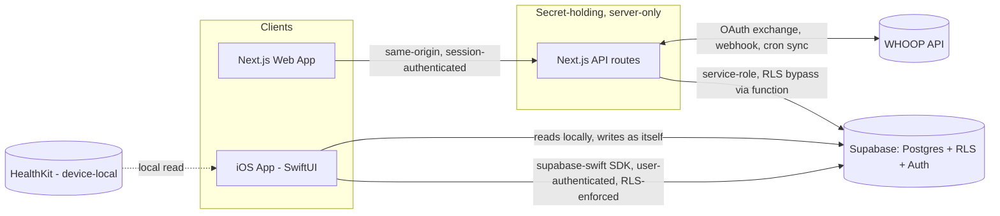
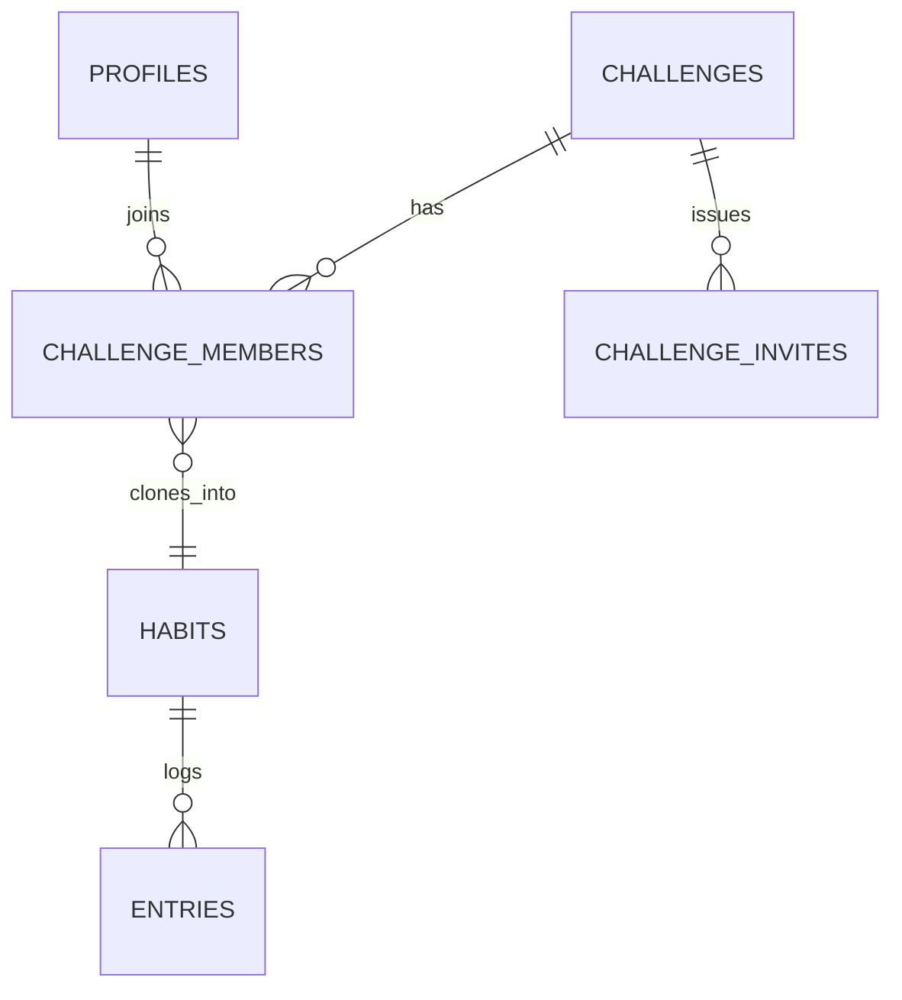

# Architecture Spine — Motion: Competitive Layer + iOS Client

## Design Paradigm

Thin-client over a Row-Level-Security-enforced Backend-as-a-Service, with a thin secrets-mediation layer for the one integration (WHOOP) that needs server-held credentials.

- **iOS client** (SwiftUI) — presentation + local device boundaries (HealthKit) only. No business logic that duplicates server-enforced rules.
- **Supabase** (Postgres + RLS + Auth + Realtime) — the single source of truth for data, authorization, and now leaderboard ranking. Both the existing web app and the new iOS app are RLS-equal peers of it.
- **Next.js API** (existing, unchanged in role) — not a general backend; it exists *only* where a secret can't live on a client: WHOOP OAuth code exchange, WHOOP webhook receipt, cron-driven WHOOP sync.



## Invariants & Rules

### AD-1 — Backend of record stays Supabase; extended additively

- **Binds:** all
- **Prevents:** a parallel backend, or a destructive schema rewrite that discards the working auth/pairing/WHOOP system already in production.
- **Rule:** new capability lands as additive migrations (new tables/functions/policies) in `supabase/migrations/`. Existing tables (`pairs`, `memberships`, `habits`, `entries`, `goals`, `messages`, `reviews`, `provider_connections`) are never dropped or redefined by this feature.

### AD-2 — A challenge is one habit definition, cloned per member

- **Binds:** `challenges`, `challenge_members`, leaderboard
- **Prevents:** per-member target drift that would force ratio/percentage normalization to rank fairly. [ADOPTED — user: "everyone should have the same habits in the group."]
- **Rule:** `challenges` holds exactly one `{title, category, period, kind, target, unit}`. Joining a challenge clones that definition verbatim into a new row in the member's own `habits`, tagged via `challenge_members.habit_id`. Ranking never compares across differing targets. **A cloned habit row is frozen while its `challenge_members` link is active**: the existing generic habit-edit/delete UI (unmodified under AD-1) must not be allowed to change a clone's `target`/`period`/`kind`/`unit` or delete it out from under a live challenge — enforced by a Postgres trigger/check (not a per-client UI convention, since web and iOS are independent peers under AD-3 and must not diverge on this). Leaving a challenge is the only sanctioned way to free the row (mechanism deferred — see Deferred). Creating a challenge atomically enrolls its creator as the first `challenge_members` row (via the same function that creates the `challenges` row, not a bare client-side insert) so creator membership is never ambiguous between clients.

### AD-3 — Clients reach Supabase directly; Next.js is secrets-only

- **Binds:** iOS client, Next.js API
- **Prevents:** a duplicate "mobile API" layer whose contract can drift from Supabase's own RLS-enforced one.
- **Rule:** the iOS app authenticates and queries Supabase directly via `supabase-swift`. The only Next.js routes it ever calls are the three already client-invoked WHOOP endpoints — `connect` (GET, redirects to WHOOP's OAuth page), `disconnect` (POST), `sync` (POST). `callback` (the OAuth redirect target), `webhook` (WHOOP-initiated), and `reconcile` (cron-initiated, `CRON_SECRET`-gated) are never called by any client, mobile or web. No new Next.js endpoint may be added solely to serve the iOS app data Supabase could serve directly under RLS.

### AD-7 — WHOOP's client-facing routes need bearer-auth support before iOS can call them [gap, not yet closed]

- **Binds:** `app/api/whoop/connect`, `disconnect`, `sync`
- **Prevents:** AD-3 being assumed workable when it isn't yet. As written, `authenticated()` reads a browser cookie session (`@supabase/ssr`) and `sameOrigin()` requires an `Origin` header matching the app's own origin — a native `URLSession` request sends neither. Calling these routes from iOS today fails outright.
- **Rule:** before the iOS WhoopLink feature can ship, these three routes must additionally accept `Authorization: Bearer <supabase JWT>`, verify it server-side via Supabase (not the cookie path), and `sameOrigin()` must be relaxed for bearer-authenticated non-browser requests (e.g. skip the origin check when a valid bearer token is present) rather than removed outright for the cookie-based web path.

### AD-4 — Two integration sync mechanisms, by necessity

- **Binds:** WHOOP integration, HealthKit integration
- **Prevents:** a future attempt to build a server-side HealthKit poller — Apple provides no such access.
- **Rule:** WHOOP stays server-pulled (webhook + cron, service-role, as already built). HealthKit is device-pushed: the iOS app reads `HKObserverQuery` results itself and writes `entries` rows to Supabase as the authenticated user. These are different mechanisms serving the same `entries` table — not two ad hoc variants of one. **This requires a schema change, not just client code**: the existing `entries_insert` policy hardcodes `with check(user_id=auth.uid() and source_key='manual')`, which rejects a direct user-authenticated HealthKit write outright. The policy must be additively widened (e.g. also accepting `source_key like 'healthkit:%'` for `user_id=auth.uid()` inserts) before AD-5's "guaranteed foreground sync" can land a single row. Scope this in the same migration that adds the `challenges` tables, not as a surprise discovered mid-build.

### AD-5 — HealthKit background delivery is a latency optimization, not the sync path

- **Binds:** iOS HealthKit sync
- **Prevents:** shipping a leaderboard that silently goes stale on devices where background delivery throttles or stalls. [Verified via web research, Oct 2026: `enableBackgroundDelivery` frequency is inconsistent across devices — reports of ~hourly throttling and watchOS 26 delivery silently stopping until restart.]
- **Rule:** `HKObserverQuery` + `enableBackgroundDelivery` registers for opportunistic updates, but every app foreground/launch triggers an unconditional, synchronous HealthKit → Supabase sync. The guaranteed path is foreground sync; background delivery only improves on it when the OS cooperates.

### AD-6 — Leaderboard ranking AND its period-bounds arithmetic are computed server-side

- **Binds:** leaderboard / challenge progress, any client-side display of period/deadline info (e.g. a WhatsApp share card's "days left")
- **Prevents:** the existing TypeScript `progress()` logic (period bounds, manual-vs-imported precedence) and an independent Swift reimplementation diverging on edge cases (DST boundaries, period rollover, etc.) — including indirectly, via a client recomputing *inputs* to rank (like period boundaries) even if it never computes rank itself.
- **Rule:** ranking AND the period start/end it's based on are a single Postgres view/function joining `challenge_members → habits → entries`, porting the rules already proven in `lib/domain.ts`. Neither client computes its own ranking *or* its own period boundaries — e.g. a share card's "2 days left" must read that number from the server payload, never recompute it from `Date()` locally. If Realtime is used for live leaderboard updates (see Deferred), table-change events are an invalidation signal only — they trigger a re-fetch of the ranked view, never a client-side re-derivation of order from the raw row deltas.

## Consistency Conventions

| Concern | Convention |
| --- | --- |
| Naming (entities, files, interfaces, events) | New tables/functions follow existing snake_case SQL conventions (`challenge_members`, `join_challenge`). Swift types mirror server entity names in UpperCamelCase (`ChallengeMember`), matching the existing TS convention of 1:1 server-entity-to-client-type naming in `lib/domain.ts`. |
| Data & formats (ids, dates, error shapes, envelopes) | UUIDs for all ids (`gen_random_uuid()`), `date` (not timestamp) for the day-granularity fields already used by `entries.day`, ISO-8601 via Supabase's default Postgres↔JSON encoding — no new date format introduced for the iOS client. |
| State & cross-cutting (mutation, errors, logging, config, auth) | All writes go through RLS-checked client calls or `security definer` functions. New definer functions (`join_challenge`, `create_challenge_invite`, `create_challenge`) follow the **hardened** pattern from `20260927172350_harden_motion_access.sql` — the real logic lives in `private` as `security definer`, with a thin `public` wrapper as `security invoker` — not the pre-hardening pattern from the initial migration. Auth session persistence uses `supabase-swift`'s default Keychain-backed storage. |

## Stack

| Name | Version |
| --- | --- |
| supabase-swift | v2.50+ (verified current, July 2026) |
| Swift | 6.1+ (SDK minimum) |
| Xcode | 16.3+ (SDK minimum); install current App Store release |
| iOS deployment target | 17.0+ (project choice, above the SDK's 16.0 floor — unlocks `@Observable`) |
| UI framework | SwiftUI |
| Existing backend (unchanged) | Supabase Postgres + Auth + Realtime; Next.js (Vercel) for WHOOP secrets-mediation |

## Structural Seed

```text
ios/
  Motion/
    MotionApp.swift          # app entry, Supabase client init, session bootstrap
    Models/                  # Swift structs mirroring server entities (Habit, Entry, Challenge, ChallengeMember, Profile)
    Services/
      SupabaseClient.swift   # single shared client instance (auth + postgrest + realtime)
      HealthKitSync.swift    # HKObserverQuery setup, background delivery registration, foreground sync trigger
      WhoopLink.swift         # thin wrapper calling the existing Next.js WHOOP routes (connect/disconnect/sync)
    Features/
      Today/                 # own habits + check-in (mirrors existing Today job)
      Challenges/            # browse/create/join a challenge, invite-link flow
      Leaderboard/           # ranked view for one challenge, reads the server-side ranking view
      Together/               # existing pairing/support feature, unchanged in shape
      You/                    # profile, WHOOP connect, settings
    Share/
      ChallengeShareCard.swift # builds the shareable result text/image for the native share sheet (WhatsApp target)
supabase/migrations/
  20261010000000_challenges.sql   # draft from this session - review before applying
```



## Deployment & Environments

- **Dev:** iOS Simulator / a device wired to Xcode, pointed at the existing Supabase project (same one the web app uses — no separate dev project).
- **Pilot distribution:** TestFlight internal testing track — up to 100 testers, no App Review wait. Requires enrollment in the Apple Developer Program (paid, ~$99/year) before any build can be distributed beyond a device connected directly to Xcode. **Open question, not yet resolved:** does the team already have an Apple Developer account? If not, that enrollment should start immediately — it can gate the whole "playable by end of week" target independent of how fast the app itself gets built.
- **Production (future):** public App Store release, once the pilot validates the loop — out of scope for this spine.

## Deferred

- **Android client, web parity for the competitive layer** — out of scope per the product brief; revisit once the iOS pilot validates the loop.
- **Screen Time integration** — confirmed not viable (no cross-user export path on Apple's API); stays out.
- **Monetization** — not designed; free for v1.
- **Challenge lifecycle detail** (ending/archiving a challenge, a `leave_challenge()` function to unfreeze a cloned habit per AD-2, re-matching after a target change) — left to story-level detail; AD-2's freeze trigger and atomic `create_challenge`/`join_challenge` enrollment are now in the draft migration, but there is still no exit path out of a challenge.
- **Realtime vs. pull-to-refresh for the leaderboard** — either fits AD-6 as now written (Realtime as invalidation-only signal); pick at implementation time based on how much polish the pilot week allows.
- **Testing strategy for the iOS app** — the web app has an established Vitest/Playwright culture; the Swift equivalent (XCTest/Swift Testing for the ranking/HealthKit-mapping logic at minimum) is a story-level decision, not fixed here.
